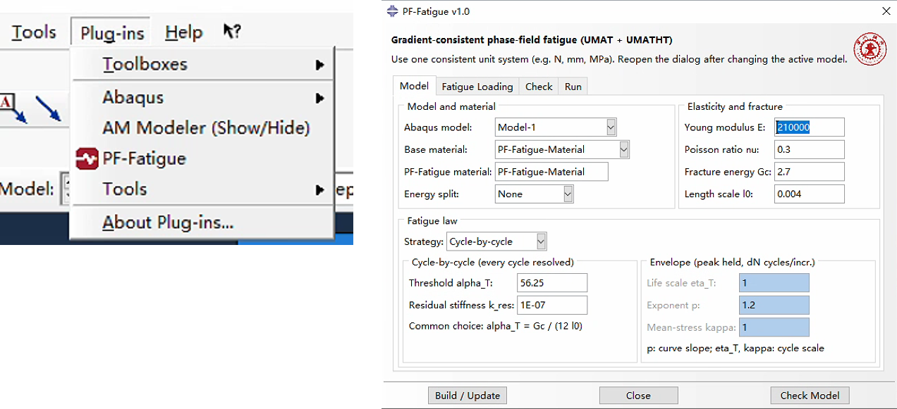
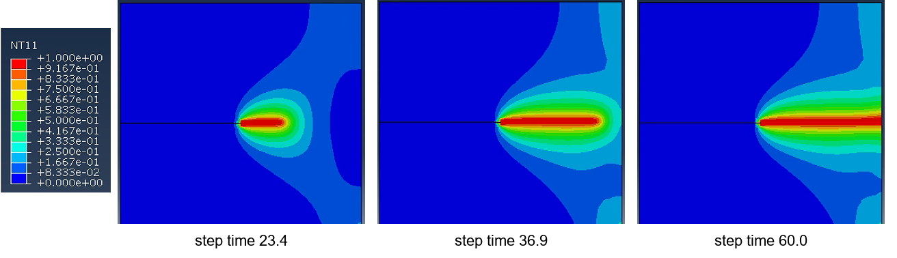
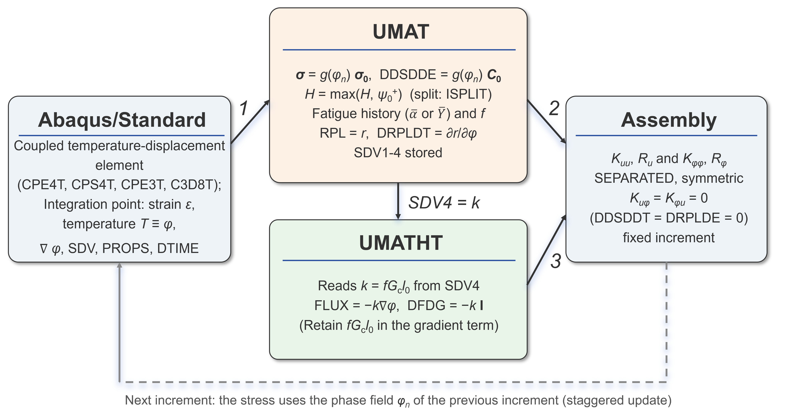

# Abaqus-PhaseField-Fatigue

Gradient-consistent phase-field fatigue fracture in Abaqus/Standard with a UMAT + UMATHT pair (package name
PF-Fatigue-GC).

The package accompanies *Phase-field fatigue modeling: Gradient consistency and scaling-based
calibration* (K. Kang, Y. Chen, P. Ying, J. Huang, Y. Liu), a manuscript submitted to International Journal
of Fatigue. It contains the
user subroutines of the article, the input files of the two SENT examples, scripts for post-processing and
parameter identification, and the Abaqus/CAE plug-in PF-Fatigue v1.0.

The full description is in the folder `manual/`: `PF-Fatigue-GC_Documentation.pdf` (implementation, model
set-up in Abaqus/CAE, a documented SENT example, parameter identification and theory) and
`PF-Fatigue_v1.0_User_Guide.pdf` (step-by-step guide to the plug-in). This README is a summary.



*The PF-Fatigue plug-in in Abaqus/CAE: menu entry (left) and Model tab of the dialog (right).*



*Phase field φ (NT11) of a seam-crack example built with the plug-in, at three cycle numbers.*

## 1. Principle

The phase field φ is the temperature degree of freedom of the Abaqus coupled temperature–displacement
elements. The fatigue degradation function *f* multiplies the fracture resistance. In the
gradient-consistent (GC) form the phase-field equation is
div(*f G*c *l*₀ ∇φ) + 2(1−φ)*H* − *f G*c φ/*l*₀ = 0.
UMAT returns the source 2(1−φ)*H* − *f G*c φ/*l*₀ and stores *k* = *f G*c *l*₀ in SDV4.
UMATHT reads this coefficient and returns q = −*k*∇φ and its gradient derivative −*k*I.
For spatially constant *G*c *l*₀, normalization gives the coupling term (∇ ln *f*)·∇φ.
The local-equivalent (LE) file uses unit conductivity and the source
2(1−φ)*H*/(*f G*c *l*₀) − φ/*l*₀² for single-material comparison.

The GC implementation uses one continuous phase field across material interfaces. With no separate
interface energy or source, the weak form gives continuity of the normal flux *f G*c *l*₀ ∇φ·n.
Each material supplies its local *G*c and *l*₀; no reference normalization constant is needed
(article, Supporting Information S8).



*Data flow in one increment: UMAT updates the stress and history variables and stores k = fGc l₀ in SDV4; UMATHT returns the flux −k∇φ. The stress of the next increment uses the phase field of the previous one (staggered update).*

## 2. Contents

| Folder | Content |
|---|---|
| `src/` | Fortran user subroutines (UMAT and UMATHT in one file each) |
| `examples/` | input files of the SENT examples under Mode-I and Mode-II loading |
| `postprocessing/abaqus_python/` | ODB extraction scripts (run with `abaqus python`) |
| `postprocessing/identification/` | S–N and Paris parameter identification (Python 3, numpy, scipy) and the experimental data of the article |
| `plugin/` | Abaqus/CAE plug-in PF-Fatigue v1.0 |
| `manual/` | documentation (`PF-Fatigue-GC_Documentation.pdf`) and plug-in User Guide (`PF-Fatigue_v1.0_User_Guide.pdf`) |
| `images/` | figures of this README |
| `LICENSE`, `CITATION.cff` | licence, citation |

## 3. User subroutines

| File | Fatigue law | Use |
|---|---|---|
| `PF_Fatigue_Exact_EnergySplit.f` | cycle by cycle, GC | resolved load cycles (SENT examples) |
| `PF_Fatigue_LE_EnergySplit.f` | cycle by cycle, LE | single-material comparison with unit conductivity and the normalized LE source |
| `PF_Fatigue_GC_Envelope_Final.f` | cycle domain (peak-load envelope), GC | long lives, S–N, Paris and structural examples; each increment represents ΔN cycles |

### Material constants (`*User Material, type=MECHANICAL`)

| PROPS | Cycle by cycle (7) | Cycle domain (9) |
|---|---|---|
| 1 | E | E |
| 2 | ν | ν |
| 3 | *G*c | *G*c |
| 4 | *l*₀ | *l*₀ |
| 5 | α_T (fatigue threshold) | η_T (dimensionless threshold) |
| 6 | *k*res (residual stiffness) | ISPLIT |
| 7 | ISPLIT | *p* (exponent) |
| 8 | – | *R* (stress ratio) |
| 9 | – | κ (mean-stress parameter) |

ISPLIT selects the energy split of the crack driving force: 0 none, 1 Amor (volumetric–deviatoric),
2 Miehe (spectral), 3 no-tension. The whole stress is degraded (hybrid formulation). The cycle-domain file
uses *k*res = 10⁻⁶ internally. A thermal user material with one placeholder constant (value 1) and
`*Depvar` = 4 are also needed. The GC conductivity is computed from the mechanical constants in UMAT,
not from this thermal placeholder. The 7/9 mechanical constants and four state variables are unchanged.
The cycle-by-cycle and cycle-domain files use different constants and state variables.

### State variables

| SDV | Cycle by cycle | Cycle domain |
|---|---|---|
| 1 | accumulated fatigue variable ᾱ | accumulated history Ȳ |
| 2 | history field *H* | history field *H* |
| 3 | α of the previous increment | equivalent driving force *Y*eq |
| 4 | GC: conductivity *k* = *f G*c *l*₀; LE: degradation *f* | conductivity *k* = *f G*c *l*₀ |

For a GC material, recover the dimensionless degradation as *f* = SDV4/(*G*c *l*₀) using that material's
constants. The lower bound 10⁻¹² is applied to *f* in UMAT; no separate fixed absolute floor is applied to
*k* in UMATHT. The LE file retains SDV4 = *f* and unit conductivity.
Interpret SDV4 in existing ODBs according to the source version that generated them. Restart migration
from the previous normalized release has not been verified.

In the source code and the plug-in, the history Ȳ, the driving force *Y*eq, the peak energy *Y*max and the factor β = (1−R)/2 of the article are named Abar, Aeq, Amax and S; the code names were kept.

### Analysis settings

* `*Coupled Temperature-displacement, steady state` with `*Solution Technique, type=SEPARATED`
  (staggered update). The temperature NT11 is the phase field: 0 intact, 1 broken.
* Cycle by cycle: triangular load amplitude; fixed increment 1/IPC of a cycle.
* Cycle domain: the peak load is held; the step time is the cycle number and the fixed increment is ΔN.
  *R* enters only through the material constants. The increment is not adapted during the analysis.
* The previous normalized release was tested with Abaqus/Standard 2023 and Intel Fortran 19.1
  (Visual Studio 2019) on Windows. Verification of this raw-form update is recorded in Section 8.

## 4. Quick start

```bat
cd examples\SENT_I_tension
abaqus job=SENT_I_GC input=SENT_I_IPC128.inp user=..\..\src\PF_Fatigue_Exact_EnergySplit.f cpus=8 interactive
abaqus job=SENT_I_LE input=SENT_I_IPC128.inp user=..\..\src\PF_Fatigue_LE_EnergySplit.f cpus=8 interactive
abaqus python ..\..\postprocessing\abaqus_python\extract_crack_curve_SENT.py SENT_I_GC.odb
```

Both examples use N, mm and MPa; run each in its own working directory.

* `examples/SENT_I_tension/SENT_I_IPC128.inp` (article Figs. 2 and 3): IPC = 128, 350 cycles, ISPLIT = 0. For
  another IPC, set the fixed increment (line after `*Coupled Temperature-displacement`) to 1/IPC and the output
  frequency to IPC. Crack extension: `extract_crack_curve_SENT.py`.
* `examples/SENT_II_shear/SENT_II_IPC16.inp` (article Figs. 4 to 6): IPC = 16, 2000 cycles, ISPLIT = 2. The file
  declares `*Depvar` = 7, as in the runs of the article; the subroutines use SDV1–SDV4 only. Crack extension along
  the curved crack: `extract_crack_curve_general.py`; paths at matched crack extension: `export_sent2_path_raw.py`;
  initiation angle: `extract_SENT2_initiation_angles.py`.

Each run can be repeated with `src/PF_Fatigue_LE_EnergySplit.f` for the LE comparison. The input files of the
other examples of the article are not part of this package. The ODB scripts open results read-only.
Run them from the results directory, using the actual arguments below; the script paths are relative
to `postprocessing/abaqus_python/`. Initial crack-tip and geometry settings are at the top of each script.

| Script | Invocation and settings |
|---|---|
| `extract_crack_curve_SENT.py` | `abaqus python <script> job.odb` |
| `extract_crack_curve_general.py` | `abaqus python <script> job.odb` or `abaqus python <script> --all` |
| `export_sent2_path_raw.py` | `abaqus python <script> GC_job.odb LE_job.odb`; edit `MATCHED_STAGES` for other results |
| `extract_SENT2_initiation_angles.py` | `abaqus python <script>`; set `ODB_CASES` for the actual job names |
| `extract_CT_crack_history.py` | `abaqus python <script>`; set `ODB_DIR`, `ODB_NAME_FILTER` and the CT geometry settings |

Batch extraction returns a nonzero exit status if any requested result fails. Successful cases are
still written so their data can be inspected. The CT summary's 5–15 l₀ rate is an early-window
diagnostic; Paris identification uses the crack histories after the first 20 l₀. CSV column names
and the crack-length calculations are unchanged.

## 5. Numerical settings

* Mesh: element size h ≤ *l*₀/2 along the crack path.
* Cycle by cycle: the result depends on IPC; compare formulations at the same IPC.
* Cycle domain: the resolution is set by the scaled increment ΔN* = ΔN·β^(2κp)/η_T with β = (1−R)/2 (Eq. (28) of the article), not
  by ΔN. A fixed ΔN gives a different resolution at each *R*. The crack-growth calculations of the
  article use ΔN* = 0.625. The plug-in reports ΔN* and warns above 1.
* Initial transient: growth rates in the first ≈20 *l*₀ from a sharp notch are not in the Paris regime
  and are excluded from the identification.

## 6. Parameter identification

`postprocessing/identification/` contains

* `sn_identify.py`: homogeneous S–N life F_p(ρ), ρ = σmax/σc, and identification of *p*, η_T and κ from the curves at
  R = −1 and 0. With `sn_experimental_data.csv` it reproduces the parameters of the article (Table 2).
* `paris_identify.py`: identification from reference crack-growth calculations of a CT specimen
  (η_T = 1, R = −1, trial values of *p*) and the measured curves at two stress ratios. The reference
  calculations are run by the user; `paris_experimental_data.csv` contains the measured rates of the
  article. The reference crack histories used in the article are available from the corresponding author
  on request.

The identification scripts require Python 3 with NumPy and SciPy. A Paris identification that is not
bracketed by the supplied reference calculations writes its diagnostic JSON and returns a nonzero exit status.

```bat
cd postprocessing\identification
python sn_identify.py
python paris_identify.py windows
python paris_identify.py identify <material> <folder with reference crack histories>
```

Use `AA6005A-T6` or `Q345qC` for `<material>` and quote a reference-folder path that contains spaces.
The reference crack histories are written by `extract_CT_crack_history.py`. The experimental points are
taken from the publications cited in the article.

## 7. Plug-in

`plugin/PF_Fatigue` is an Abaqus/CAE 2023 plug-in that sets up the material, the step, the amplitude, the
output, an optional initial crack and the job for either fatigue law. Installation and use are described
in `manual/PF-Fatigue_v1.0_User_Guide.pdf`.

## 8. Verification

The current update restores the raw gradient coefficient *f G*c *l*₀ and the matching source and
tangents. The tables distinguish checks of this update from solver runs of the previous normalized release.

| Current raw-form update | Result |
|---|---|
| Compiled material-point UMAT/UMATHT tests, Intel Fortran 2016 | Each GC file passes 1,440 scenarios and 84,033 checks, with zero failures. These tests use solver stubs and are not Abaqus solver runs. |
| Comparison with the previous normalized subroutines | Source, flux and tangents have the expected *Gc l*₀ scaling; stress, stiffness and fatigue histories agree. Maximum relative discrepancies are below 4 × 10⁻¹⁶ in the tested scenarios. |
| Invalid SDV4 or insufficient state variables | Both GC files stop with the intended error message. |
| Abaqus/Standard 2023, Intel Fortran 19.1 | Six short solver regressions completed: old/raw cycle and envelope comparisons, a two-material interface and a 3D envelope case. Numerical checks passed; three actual CAE plug-in build/write-input checks also passed. |

| Previous normalized release | Recorded result |
|---|---|
| `SENT_I_IPC128.inp`, GC and LE (Abaqus 2023, 12 CPUs) | a(N) identical at every output cycle to the runs of the article (GC N = 0–253, LE N = 0–237). These runs preceded the clipped-branch tangent revision of 12 October 2026. |
| Cycle-domain file vs. the homogeneous closed form (56 single-element S–N cases) | Lives 0.18–0.36 % above the closed form; halving ΔN changes them by at most 0.15 %. |
| Cycle scaling of the cycle-domain law (CT specimens) | Lives and rates at different *R* follow from one reference calculation by rescaling the cycle count. |
| Plug-in kernel (2D cycle by cycle, 2D and 3D cycle domain, error checks) | Abaqus 2023 tests passed. |
| Plug-in dialog | Check Model, Build and a seam-crack example ran in Abaqus/CAE 2023 (User Guide, Section 7). |

## 9. Known issue

`LINK : fatal error LNK1105: cannot close file "standardU.dll"` can appear on Windows when several jobs
compile at the same time or a virus scanner holds the new DLL. The solver has not started in this case;
submit the job again.

## 10. Licence and citation

The package is released under the MIT License (`LICENSE`), with two exceptions. The emblem of Xi'an Jiaotong
University in `plugin/PF_Fatigue/icons/xjtu_logo_*.png` is a trademark of the university; remove or replace these
files when the plug-in is redistributed in modified form. The experimental data in
`postprocessing/identification/*.csv` are taken from Zhang et al. (2016) and Rubio Ruiz et al. (2023) for the
stress-life data and from Zhou et al. (2023) and Ke et al. (2023) for the crack-growth data; please cite these
sources when the data are used. Please cite the article given in `CITATION.cff`.
